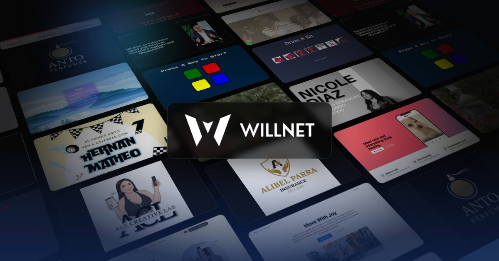

# WillNet · Landing page

Bilingual (**English / Spanish**) landing page for **WillNet**, the web design & development brand of **Willder Gómez**, based in West Palm Beach, Florida.

🌐 **Live:** https://willnet.dev



## Features

- **Bilingual EN/ES**: English by default and Spanish with one click (or `?lang=es`). The choice is remembered and also updates the page title, meta tags and WhatsApp/SMS messages.
- **Liquid-glass header** that follows the scroll and turns into a floating pill. The mobile menu uses the same glass style.
- **Animated project wall** in the hero: columns of portfolio screenshots scroll upward at different speeds on a tilted 3D plane (pure HTML + CSS, no video). Click a screenshot to open the project.
- **Typewriter effect** in the hero that cycles through `<Web Developer>`, `<Web Designer>`, `<E-commerce Builder>` and `<Brand Designer>`.
- **Collapsible portfolio** with 18 projects and filters. Three projects show on desktop (two on mobile) until you open the rest, and on phones every card uses a mobile screenshot of the project.
- **"How I work" section** that highlights each step in a loop and pauses when you pick one.
- **Contact** by WhatsApp, text message, phone call, email or a form ([Web3Forms](https://web3forms.com)).
- **Back-to-top button** with a reading-progress ring.
- Scroll animations with GSAP, mobile-first layout, and support for users who prefer reduced motion.

## Tech stack

| Area | Tools |
|---|---|
| Markup & logic | HTML5 and vanilla JavaScript |
| Styles | Tailwind CSS v4 (CLI, configured in CSS with `@theme`) |
| Animations | GSAP 3.12 + ScrollTrigger |
| Icons | Bootstrap Icons, Simple Icons and Devicon |
| Contact form | Web3Forms |
| Hosting | Cloudflare Workers (static assets) with the custom domain `willnet.dev` |

## Getting started

Requirements: **Node.js 18+** and **Python 3** (for the local server).

```bash
npm install        # first time only
npm run dev        # Tailwind in watch mode: rebuilds css/styles.css on every save
npm run serve      # local server at http://localhost:5500
npm run build      # minified CSS
npm run deploy     # build + copy to dist/ + publish to Cloudflare
```

Edit `index.html`, `css/input.css` and the files in `js/`. **Do not edit `css/styles.css`**: it is generated.

## Project structure

```
index.html              page content (English) with data-i18n keys
css/input.css           Tailwind source: color tokens and components
css/styles.css          generated CSS
js/i18n.js              language switcher and Spanish translations
js/main.js              menu, portfolio, typewriter, header, back-to-top, process loop, GSAP
js/contact.js           contact form (Web3Forms)
assets/img/portafolio/  project screenshots (*-movil.jpg = mobile version)
assets/img/hero/muro/   lightweight thumbnails for the hero wall
assets/img/tecnologias/ white tech icons for the carousel
docs/generar-muro.js    builds the hero wall columns (node docs/generar-muro.js)
wrangler.jsonc          Cloudflare Workers configuration
```

## How the translations work

The English text lives in `index.html`. Each translatable element has a `data-i18n="key"` attribute (or `data-i18n-attr` for attributes such as `alt`), and the Spanish version of every key is in `translations.es` inside `js/i18n.js`. When you add new text, write it in English in the HTML and add its key in Spanish to `i18n.js`.

## Contact

📧 [contact@willnet.dev](mailto:contact@willnet.dev) · 💼 [LinkedIn](https://www.linkedin.com/in/will-net/) · 🐙 [GitHub](https://github.com/willnet-dev)

---

## Español

Landing **bilingüe (inglés / español)** de **WillNet**, la marca de diseño y desarrollo web de **Willder Gómez**, en West Palm Beach, Florida. Está publicada en **https://willnet.dev**.

- **Hecha con:** HTML, JavaScript y Tailwind CSS v4, animada con GSAP y publicada en Cloudflare Workers.
- **Incluye:**
  - inglés por defecto y español con un clic;
  - muro de proyectos animado en el hero;
  - header de vidrio líquido;
  - efecto de máquina de escribir;
  - portafolio plegable con capturas móviles;
  - proceso de trabajo animado;
  - contacto por WhatsApp, SMS, llamada, correo y formulario;
  - botón para volver arriba.
- **Para trabajar en ella:** `npm install`, luego `npm run dev` y `npm run serve` (abre http://localhost:5500). Para publicar: `npm run deploy`.
- **Para agregar un texto:** se escribe en inglés en `index.html` con su `data-i18n` y su traducción al español en `js/i18n.js`.

Contacto: [contact@willnet.dev](mailto:contact@willnet.dev)
